# BankSphere: Online Banking Management App

[](https://github.com/aniquasamar/BankSphere/actions/workflows/ci.yml)

A full-stack MERN banking application with role-based dashboards for **admins, employees and customers**:
accounts, branches, deposits, withdrawals, account-to-account transfers, and a transaction ledger with
branch-wise and account-wise reporting.

**Live demo:** https://online-banking-app-frontend-theta.vercel.app

## Features

- Three roles with separate dashboards: admin, employee (branch-scoped), customer
- Account opening with photo / signature / document upload and an emailed welcome message
- Deposits and withdrawals from the employee/admin console, plus a transfer API (atomic debit + credit; UI planned), all recorded in an append-only ledger
- MongoDB aggregation pipelines for credit / debit / total summaries per branch and per account
- Searchable, date-filterable, paginated statements with PDF export and print
- Multi-branch and multi-currency setup managed from the admin panel

## Screenshots

### Admin

<table>
  <tr>
    <td>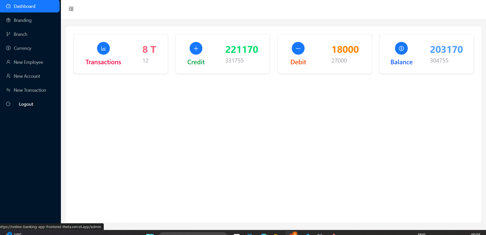<br><sub>Admin dashboard: totals from MongoDB aggregation pipelines</sub></td>
    <td>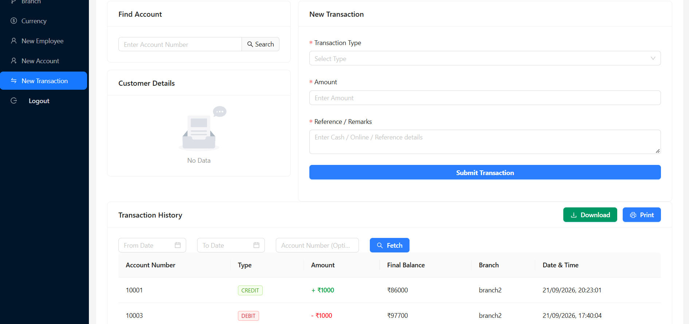<br><sub>Transactions: account lookup, deposit / withdrawal, filterable history with PDF export</sub></td>
  </tr>
  <tr>
    <td>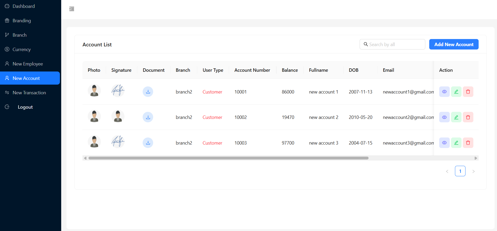<br><sub>Accounts with photo, signature and document uploads</sub></td>
    <td>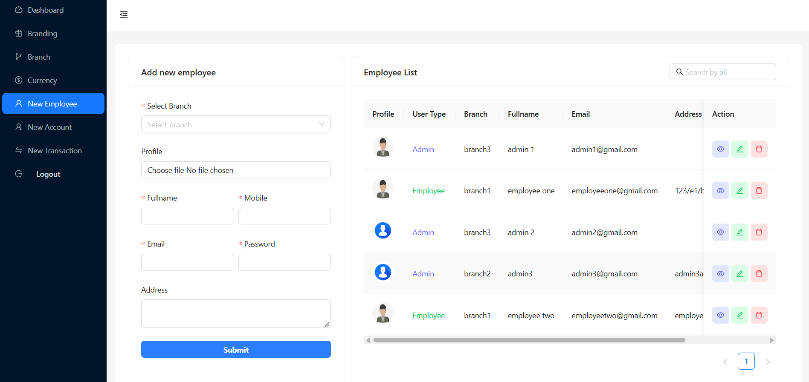<br><sub>Employee and admin management</sub></td>
  </tr>
  <tr>
    <td>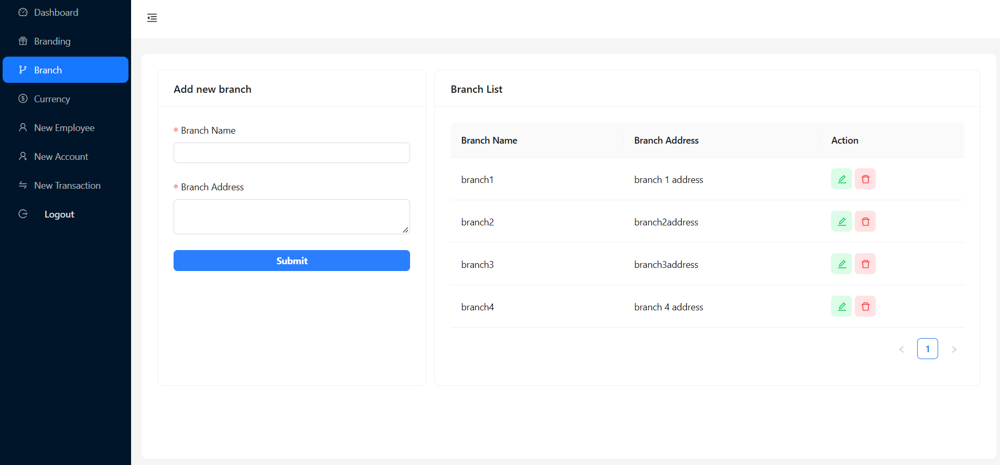<br><sub>Branch management</sub></td>
    <td>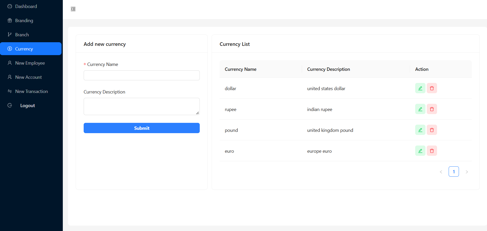<br><sub>Currency management</sub></td>
  </tr>
</table>

### Employee and customer views

Each role gets its own menu and sees only its own data: employees are limited to their branch, customers to their own account.

<table>
  <tr>
    <td>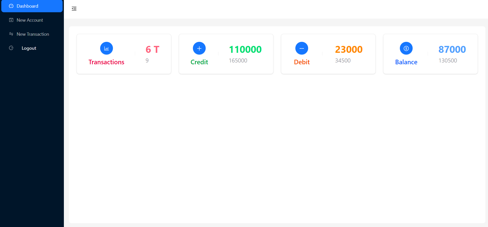<br><sub>Employee dashboard: branch-scoped totals</sub></td>
    <td>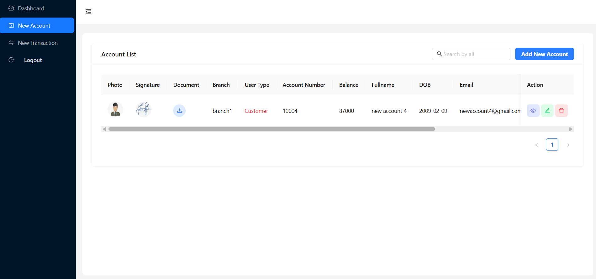<br><sub>Employee: only their branch's accounts</sub></td>
  </tr>
  <tr>
    <td>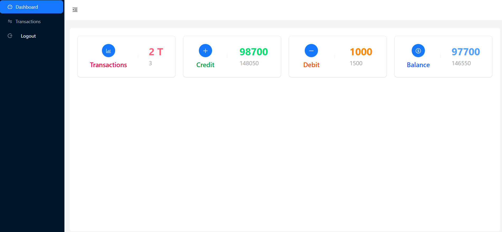<br><sub>Customer dashboard: own account totals</sub></td>
    <td>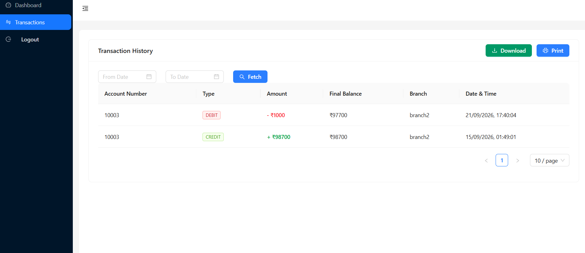<br><sub>Customer: own statement with date filter, download and print</sub></td>
  </tr>
</table>

**CI:** every push runs the test suite, builds the frontend and smoke-tests the Docker stack.

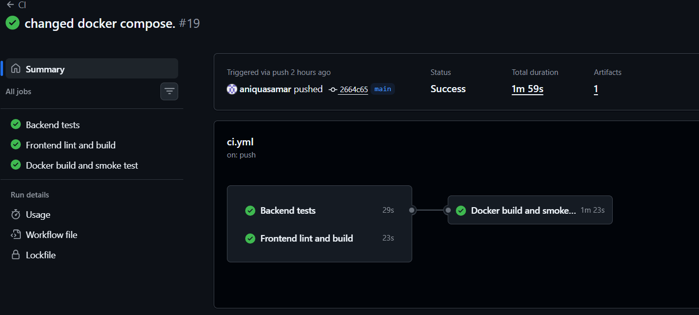

## Architecture

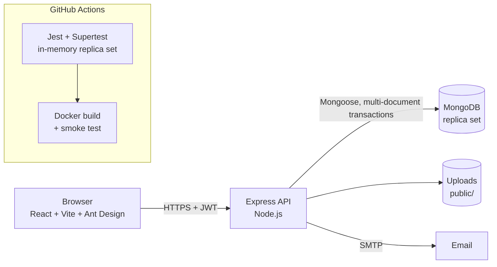

## Engineering highlights

| Area | What was done |
|---|---|
| **Money correctness** | Balances change only on the server, inside MongoDB multi-document transactions. A conditional atomic update (`balance >= amount`) makes overdrafts and race conditions impossible. Amounts are rounded server-side to avoid floating-point drift. |
| **Idempotency** | Every money-moving request carries an `Idempotency-Key`; retries and double-clicks never post twice (enforced by a unique index). |
| **Transfers** | Debit and credit legs commit together or not at all and share a `transferId`. |
| **Append-only ledger** | Transactions cannot be edited or deleted through the API. |
| **Authorization** | JWT roles plus ownership checks: employees are limited to their branch, customers to their own account. Report scope comes from the token, never from query parameters. |
| **Hardening** | Zod validation, Helmet, CORS allow-list, login and email rate limits, upload type / size / path checks, no password hashes in API responses, NoSQL operator stripping. |
| **Tests** | 88 Jest + Supertest tests against a throw-away in-memory MongoDB replica set: concurrency (parallel withdrawals), atomic rollback, idempotent retries, authorization and injection cases. 94% statement / 86% branch coverage on the transaction service, controller, routes and auth middleware. |
| **DevOps** | Multi-stage Dockerfiles, `docker compose` with a single-node replica set, GitHub Actions CI (tests with coverage, lint, build, container smoke test), Dependabot. |

## Quick start (Docker)

Requires Docker Desktop.

```bash
git clone https://github.com/aniquasamar/BankSphere.git
cd BankSphere
docker compose up --build -d
docker compose exec backend node scripts/seed.js   # demo data
```

Open http://localhost:5173. API: http://localhost:8080 (health: `/health`).

Demo logins created by the seed script (**demo only, change before any real use**):

| Role | Email | Password |
|---|---|---|
| Admin | admin@bank.test | admin123 |
| Employee | employee@bank.test | employee123 |
| Customer | customer1@bank.test | customer123 |

Stop and wipe everything: `docker compose down -v`.

## Run without Docker

MongoDB transactions need a replica set (MongoDB Atlas works out of the box).

```bash
# backend
cd backend
cp .env.example .env        # fill in DB_URL and JWT_SECRET
npm install
npm start                   # http://localhost:8080

# frontend (new terminal)
cd frontend
cp .env.example .env        # VITE_BASEURL=http://localhost:8080
npm install
npm run dev                 # http://localhost:5173
```

## Tests

```bash
cd backend
npm test                    # starts its own in-memory MongoDB replica set; no setup needed
npm run test:coverage
```

The suite has 88 tests across 2 files. Coverage is measured on the transaction service, controller, routes and auth middleware (see `jest.config.js`). The first run downloads a MongoDB binary (cached afterwards).

## Configuration

| Variable | Where | Purpose |
|---|---|---|
| `DB_URL` | backend | MongoDB connection string (replica set) |
| `JWT_SECRET` | backend | Token signing key, use a long random value |
| `CLIENT_URL` | backend | Allowed browser origin (CORS) |
| `ADMIN_EMAIL`, `ADMIN_EMAIL_PASSWORD` | backend | Gmail address and app password for outgoing mail |
| `VITE_BASEURL` | frontend (build time) | Backend URL the browser calls |

## Key endpoints

| Method | Path | Access |
|---|---|---|
| POST | `/api/login` | public, rate limited |
| POST | `/api/transactions/deposit`, `/withdraw` | admin, employee |
| POST | `/api/transactions/transfer` | admin, employee, customer (own account) |
| GET | `/api/transactions/summary`, `/pagination` | all roles, scoped by token |
| GET/POST/PUT/DELETE | `/api/customers` | admin, employee (own branch) |
| POST | `/api/customers/find-account` | all roles, scoped by token |
| CRUD | `/api/branch`, `/api/currency`, `/api/users` | admin |
| GET | `/health` | public |

Money-moving requests require an `Idempotency-Key` header.

## Project structure

```
backend/    Express API (routes, controllers, services, models, middlewares, tests, scripts)
frontend/   React app (Vite, Ant Design, Tailwind)
.github/    CI workflow, Dependabot
docker-compose.yml
```

## Roadmap

- Store money as integer minor units (paise)
- Atomic server-side account-number generation
- Refresh tokens in httpOnly cookies
- Move uploads to object storage (Cloudinary / S3)
- OpenAPI / Swagger documentation